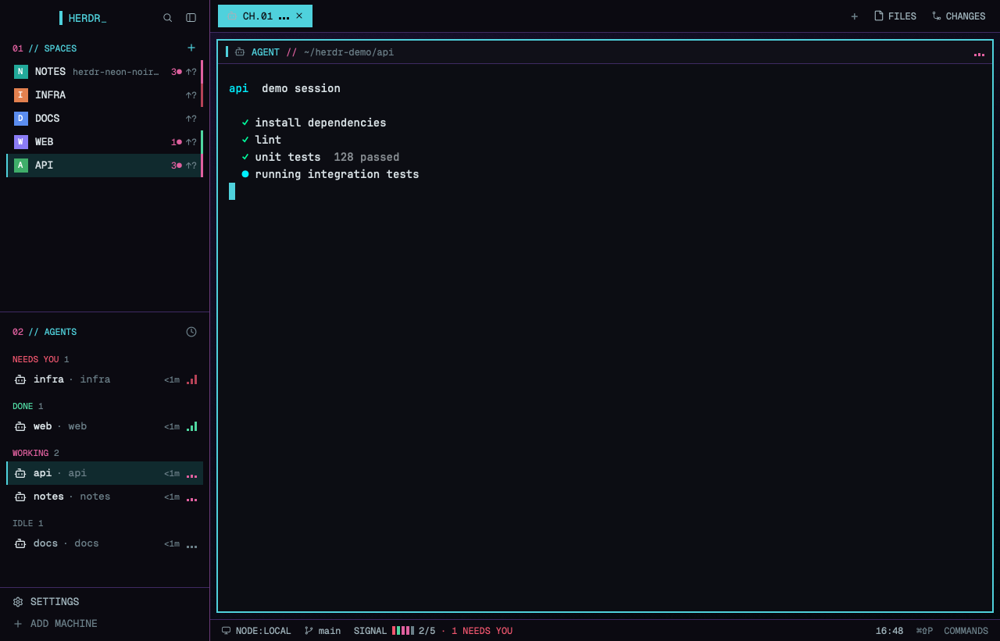

# herdr-neon-noir

A neon-noir layout for the Herdr desktop app, with live signal bars for your
agents and unsaved work on every space.



## What it adds

- **Signal bars:** three bars show each agent's status in the list, tabs and
  pane headers. They move while it works, pulse when it needs you, and sit low
  when it's idle.
- **Status notches:** each space shows its most urgent agent at a glance.
- **Unsaved work:** `3●` for changed files, `↑?` for a branch with no upstream,
  and `↑2` for commits to push.
- **`SIGNAL` meter:** five ticks in the status bar, one per agent, with the
  working count and a clock.
- **A matching window:** square popups with corner marks, numbered sections and
  a soft cyan and rose palette that's easy on the eyes.

## Contents

- `layouts/neon-noir.json` and `neon-noir.svg`: the layout and its Settings picture
- `themes/neon-noir.json`: terminal colours
- `mods/nn-*/`: the restyled mods
- `keys.json`: the keys for this layout
- `RECIPE.md`: the brief for building it from scratch

## Install

Quit Herdr first. If it's running, it can dock new mods into the layout
before their `mod.json` files arrive.

```sh
H=~/.config/herdr-app
cp layouts/neon-noir.* "$H/layouts/"
cp themes/neon-noir.json "$H/themes/"
cp -R mods/nn-* "$H/mods/"
```

Then merge the `layout:neon-noir` section of this repo's `keys.json` into
`~/.config/herdr-app/keys.json`, open Herdr, and press `cmd-shift-l` (`ctrl-shift-l` on Linux and Windows) until
Neon Noir shows.

## Notes

- `nn-palette` is a copy of the app's own screen, and the other mods are
  clones. None of them get Herdr's updates. Settings stays Herdr's own.
- Built on Herdr app 0.1.13, for macOS. Linux and Windows are untested.
- The mods run the same programs Herdr's own mods do, such as `git`, `sh` and
  `hc`. `nn-spaces` re-reads git every 30 seconds for each open space.

## Licence

Apache License 2.0, see `LICENSE`. This project includes modified Herdr code,
listed in `CHANGES.md`. See `NOTICE` and `THIRD-PARTY-NOTICES`.

This is an independent project, not affiliated with or endorsed by Herdr.
