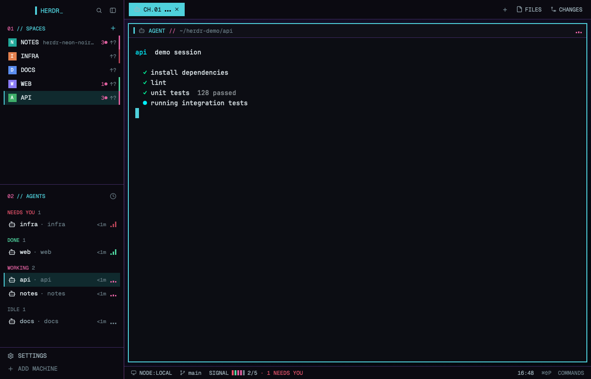

# Neon Noir

A neon-noir HUD where every agent has signal bars: three bars that move while
it works, pulse when it needs you and sit low when it's idle. Each space shows
its most urgent status and any unsaved work, and a `SIGNAL` meter counts your
agents. Near-black panels, soft cyan and rose, square corners and uppercase
labels. The structure stays the same as `main`, and the popups match too.

This file is the brief: enough to build Neon Noir from an empty folder. The
files next to it are one build of it, made on Herdr app 0.1.13. If they don't
work on your Herdr, build it again from here.

## What you see

Two columns fill the window, with no title bar:

1. **The sidebar**, 268px, `#0b0a11`, top to bottom:
   - A 46px brand row: a 4×18px cyan bar and `HERDR_` in bold cyan, then
     search and sidebar buttons.
   - `01 // SPACES` in cyan, with spaces listed in uppercase. Their letter
     tiles are square, and machine groups appear once a remote machine exists.
   - `02 // AGENTS` in cyan, with status groups in uppercase.
   - A 69px footer with `SETTINGS` and `ADD MACHINE`.
2. **The work area**, top to bottom:
   - A 42px tab bar. The active tab is solid cyan with bold `#0c0d13` text,
     and others are plain. Tab names are uppercase. On the right are `+`,
     `FILES` and `CHANGES`.
   - The terminals. Pane frames are square with a 6px gap and a 1px `#3f2a63`
     border, and the focused pane gets a 2px `#4fd1dc` border. Each pane has a
     30px header with a 3×14px marker (cyan when focused), the program icon,
     its name in bold cyan capitals, and its folder.
   - An optional 368px panel on the right, showing `// FILES` or `// CHANGES`.
     It is hidden until opened.
   - A 28px status bar: `NODE:LOCAL`, the branch, `SIGNAL` with five ticks, one
     per agent, then working/total, and the
     palette key with `COMMANDS` on the right.

Colours: canvas `#08080d`, background `#0c0d13`, surface `#101018`, raised
`#181522`, popover `#0b0a11`, selected `#102a2e`, hover `#4fd1dc14`, text
`#d9e2e6`, muted `#9fb3bb`, dim `#6b7f88`, selection `#3a1250`. Dividers are
1px `#6a3a78`. The root background is a 160° gradient from `#16102a` to
`#05090f`, mostly hidden behind the panels.

Type: Geist Mono for the interface and JetBrains Mono for terminals, both
shipped with Herdr. Terminal padding is `[14, 12]`.

Terminal theme: background `#0c0d13`, foreground `#d9e2e6`, cursor `#4fd1dc`,
and ANSI colours `#1a1d27 #ff2a55 #00ff9f #ffd166 #3aa8ff #ff2a9d #00f0ff
#d8e4e8 #6b7a8c #ff5c7c #5dffbc #ffe08a #6cc0ff #ff6ec7 #6ff7ff #ffffff`.

## How it behaves

| Status | Colour | Shown as |
| --- | --- | --- |
| blocked | `#f0566e` | Pulsing full bars, `NEEDS YOU` badge and group |
| working | `#e0609f` | Three moving bars and `WORKING` group |
| done | `#4fd6a0` | Rising bars and `DONE` group |
| idle | `#6b7f88` | Three low bars and `IDLE` group |

- The selected space, focused agent, and the chosen row in menus and lists
  get a 2px cyan left bar on `#102a2e`.
- Popups are square with a 1px cyan border and 14px rose corner marks. Primary buttons are cyan with
  dark text. This covers the right-click menus, the `+` menu, search, the
  palette, the worktree dialog, rename and close.
- `cmd-p` opens search, `cmd-shift-p` the palette, and `cmd-,` Settings.
- `f2` and `shift-f2` rename the tab and space. Double-clicking a tab also
  renames it. Leaving the name empty goes back to the automatic name.
- `cmd-w` and the tab's `×` close the tab at once, unless it is the last one.
  Closing a last tab or a space asks first, with `// CLOSE SPACE?`.
- Peek from the agents list opens a draggable window at 70% of the app's size:
  a 30px bar with the name, status, `↗ GO TO` or `↗ KEEP`, and `✕` above the
  live terminal. Closing it leaves the terminal running.

## Built from

- **The layout** (`layouts/neon-noir.json`): a clone of `main`, with a root
  `row` of `sidebar` and `work` columns, `theme: "neon-noir"`, its own `colors`
  and `terminal_menu: "nn-menu"`. Pane frames set `radius: 0`.
- **The theme** (`themes/neon-noir.json`): the terminal colours above.
- **The picture** (`layouts/neon-noir.svg`): set as `preview`, shown in Settings.
- **Clones of shipped mods**, made with `mod.clone` as `nn-<name>`: `agents`,
  `changes`, `confirm`, `files`, `machine-add`, `menu`, `new-menu`, `pane`,
  `peek`, `picker`, `prompt`, `spaces`, `tabs`, `workspace-chrome`,
  `workspace-status`, `worktree`.
- **Copy of an app screen**: `frame/palette`, as `nn-palette`. It needs its
  own `mod.json` with `place: "none"` and an `overlay` 620px wide.
- **`signal.js`**, in `nn-agents`, `nn-pane`, `nn-peek`, `nn-picker` and
  `nn-tabs`: three 3px bars with a 2px gap, moved by `.loop("height")`, with no
  timers. **`hud.js`**, in the popups: the corner marks.
- **`ask.js`**, in `nn-menu`, `nn-palette`, `nn-picker` and `nn-tabs`: opens
  `nn-prompt` or `nn-confirm` from `spaces()`, then runs `tab.rename`,
  `space.rename`, `tab.close` or `space.close`.
- **Keys**, in a `layout:neon-noir` section of `keys.json`. `nn-tabs` handles `close_tab`, `rename_tab`
  and `rename_space` through `nextCommand()`.
- **Section titles**: a rose number before cyan text, as in `01 // SPACES`.
  Automatic tab numbers show as `CH.01`.
- **Unsaved work**: each space in a repo shows `3●` for changed files, `↑?` for a
  branch with no upstream, and Herdr's own `↑2 ↓1`.
- **Clock**: `nn-workspace-status` shows the time, refreshed every 30 seconds.
- **System stats**, macOS only: `RAM` and `CPU` every 15 seconds from
  `memory_pressure`, `ps` and `sysctl`, and `NET` from one `ping` to `1.1.1.1`
  every 60 seconds. A failed read hides the label.
- **Neon Noir's signals**: a 3px notch on each space in its most urgent status,
  for blocked, done or working, and a slow-blinking `_` in `HERDR_`.
- **Peek**: `openOverlay` with `kind: "window"` and a `column` layout of a
  `nn-peek` block above a `{ terminal }` block.
- **Programs**: nothing new. The clones keep Herdr's use of `git`, `sh`, `hc`
  and the other programs its mods run. Icons are Lucide and Feather, shipped
  with Herdr.
- **Install order**: copy `themes/neon-noir.json` as well as the layout and
  mods, and merge the keys section into `keys.json`, asking before replacing
  a key the person uses for this layout. These two files aren't part of the
  usual layout install, and without them the colours and keys are incomplete.

## Watch out

- Quit Herdr before copying mods in, or write `mod.json` first. A running app
  that sees a new mod without `mod.json` docks it into the shown layout as a
  320px panel.
- `herdr-app do nn-tabs.close_tab` queues until a `nextCommand()` handler
  exists, then fires on the active tab. Don't probe commands before the
  handler is in place.
- Notifications can't be replaced. The app posts its own through the shipped
  `toast` mod, so they take the colours but keep rounded corners.
- Clicking a terminal address still opens the app's own peek, and `pane.close`
  can raise the app's own popups. Feedback and What's new stay original.
- Only the `nn-confirm` dialog may pass `confirmed: true`, and only after the
  person accepts. If the target can't be found, run the plain command so the
  app asks instead.
- A window holding a layout doesn't give its mod `props().overlay`. Save the id
  `openOverlay` returns with `setShared`, and stop mouse-down on the bar's
  buttons so dragging doesn't take their clicks.
- The clones and copies are frozen, including the code that runs programs and
  writes settings. They miss Herdr's updates, so rebuild after major releases.
- Dialog text is this build's own wording, not Herdr's.
- Settings is Herdr's own screen, so it takes the colours but keeps its shape.
- Tabs are square. The kit has no obvious way to cut corners.

## Done when

- `herdr-app check` passes for every `mods/nn-*` folder, and there is no
  `layout.error`.
- The layout shows only the `sidebar` and `work` columns, with no extra panels.
- The active tab is solid cyan, and the focused pane has a 2px cyan border.
- `FILES` and `CHANGES` open the styled panels.
- Search and the palette open as square popups with cyan borders.
- `nn-confirm` and `nn-prompt` open with the right target's name.
- Peek opens over the terminals, and after closing it the terminal still runs.
- `main` uses none of the `nn-` mods, and switching away and back works.
